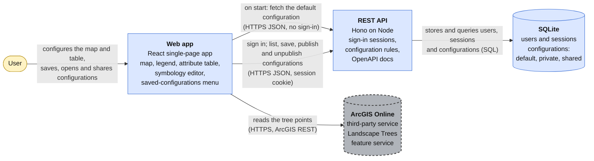

# System architecture diagram

The major components of the solution and how they interact. Arrows point from caller to callee.

Blue: built and run by this project. Dark grey with a dashed border: third-party service. Yellow: a person.

Notes:

- The default configuration is a predefined row in the database, created by the seed script (`pnpm run db:seed`) together with the demo users.
- The web app and the API share one configuration schema (`src/configSchema.ts`, zod). The web app imports only its types; the API uses it to validate requests and to generate the API documentation at `/api/docs`.
- The browser never talks to the database, and the API never talks to ArcGIS Online, so server-side validation checks the shape of a configuration but not whether its fields exist on the layer.
